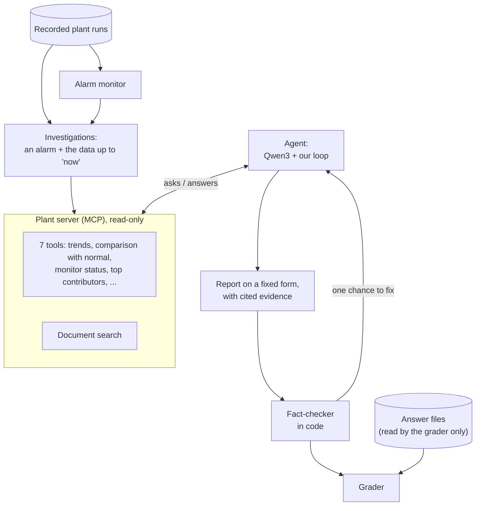
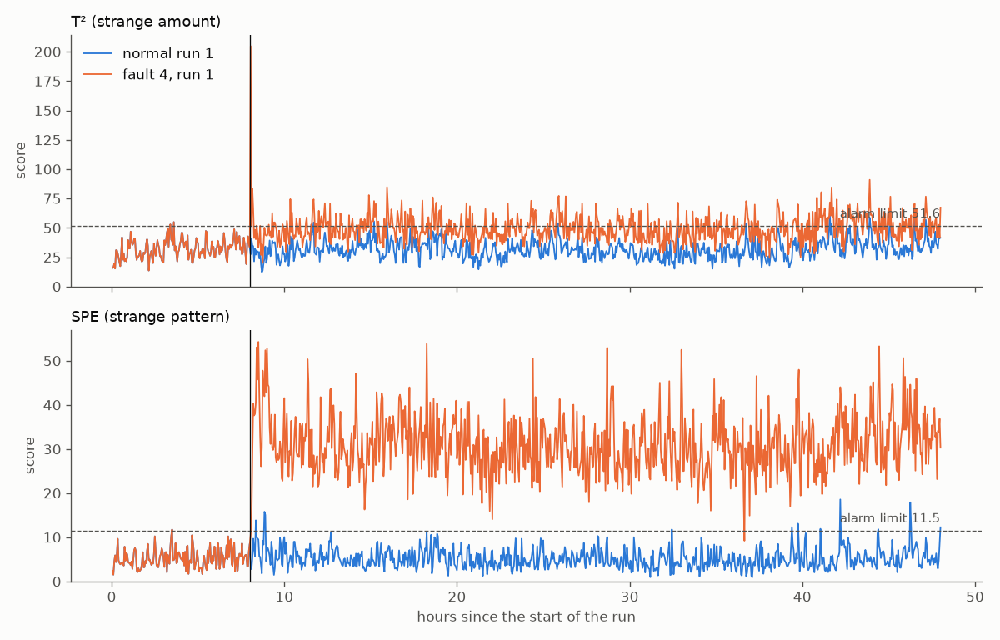
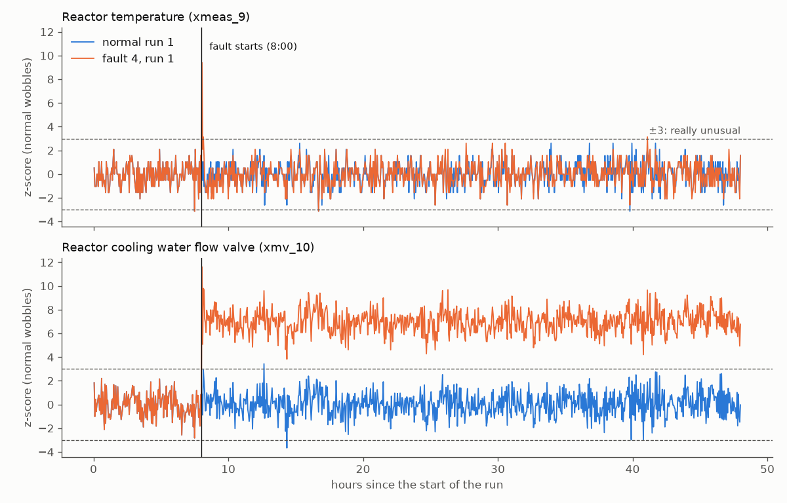

# Plant Fault Diagnosis Agent

[](https://github.com/ToumiFaycal/plant-fault-diagnosis-agent/actions/workflows/tests.yml)

An AI assistant that investigates alarms in a simulated chemical plant. When an alarm goes off, it
looks at the plant's sensor data through a set of safe, read-only tools, names the most likely
cause, and backs every claim with evidence that code checks. Because every fault in the simulation
was switched on on purpose, its answers can be graded automatically. Everything runs on one laptop.

## What it does

1. **Watches.** A statistical alarm monitor learns what a healthy plant looks like and raises an
   alarm when the plant drifts away from it.
2. **Investigates.** An AI agent receives the alarm and asks for what it wants to see: a signal's
   trend, a comparison with normal values, which signals the monitor finds most unusual, or a
   passage from the plant documents. It can't see anything after the moment of the investigation, and
   it can't change anything in the plant.
3. **Reports.** It fills in a fixed report form: no fault, a fault (and which one), or "can't
   tell", with its evidence and how confident it is.
4. **Gets checked.** Code looks up every piece of evidence in the tool result it cites. If a claim
   doesn't match, the agent gets one chance to correct its report.
5. **Gets graded.** Code compares the report with the fault that was really switched on.

No paid service is used and nothing is sent to the internet: the AI models run on the laptop.

**The plant** is the Tennessee Eastman process, a simulated chemical plant that researchers
around the world use as a shared test bench for fault detection. It has a reactor, a condenser, a
separator, a compressor and a stripper; 52 signals (41 measurements and 11 valve positions), one
reading every 3 minutes; and 20 kinds of programmed faults.

## Results so far

Every number below comes from running the code in this repository, and is logged with the commit it
came from in [results/RESULTS.md](results/RESULTS.md). These are development results: the 110 test
investigations are kept aside, untouched, for the final evaluation.

**The alarm monitor on its own.** 100 recorded runs with a fault and 10 healthy runs.

| Question | Result |
|---|---|
| How many runs of the 12 catalogued faults that show in the data raised an alarm? | 60 of 60 |
| How many runs of the 5 faults that were never described raised an alarm? | 25 of 25 |
| How many runs of the 3 faults known to be nearly invisible raised an alarm? | 1 of 15 |
| How many runs raised an alarm before their fault had even started? | 0 of 100 |
| How often does a healthy plant raise a false alarm? | about once every 114 to 160 hours |

**A classifier trained on labelled examples** (a random forest, see part 7 below).

| Question | Result |
|---|---|
| How many runs of the 12 visible catalogued faults did it name exactly? | 60 of 60 |
| How many runs of the 5 undescribed faults did it recognise? | 25 of 25 |
| How many of the 10 healthy runs did it call healthy? | **1 of 10** |

It learned from 50 labelled runs of every fault, which a real plant rarely has. And it must always
pick an answer, even when unsure (the median probability of its answer on healthy runs was 0.29),
so it called 9 healthy runs faulty.

**The agent, and the same model asked one question with no tools.** A first trial on 5
investigations, to test the whole chain from alarm to grade.

| Question | Agent | One question |
|---|---|---|
| How many answers were right? | 2 of 5 | 2 of 5 |
| How many were wrong *with high confidence*? | 1 | 0 |
| For the 2 catalogued faults, was the true fault among its top 3 guesses? | 0 of 2 | 2 of 2 |
| How many reports passed the fact-check the first time? | 2 of 5 (the other 3 were fixed on their second chance) | 4 of 5 (1 fixed) |
| How long did one investigation take? | 70.5 to 120.8 s | 37.5 to 72.3 s |

Five investigations are far too few to say which one is better. Running the same five again from
a fresh start gave exactly the same answers. Next comes the full evaluation: all 110 development
investigations, then the 110 test investigations, about 4 hours of computing per pass on this
laptop.

**Automated tests.** 142 tests check the pieces on small made-up examples. GitHub runs them after
every change (the 5 that need the data or the local models run on the laptop only). The badge at
the top shows whether they currently pass.

## How it works



**1. Recorded plant runs** ([convert_data.py](src/plantagent/convert_data.py)). The data is a public
set of simulated runs: 500 runs per fault, each with its own random seed, recorded every 3
minutes. In the runs used for investigations, the fault is switched on 8 hours in. The downloaded files are read
once and saved as compact tables (Parquet), keeping only the runs the project uses.

**2. Alarm monitor** ([monitor/](src/plantagent/monitor/)). It learns healthy operation from 100
healthy runs:
- Each signal is first measured in its own "normal wobbles" (a z-score), so a tiny but unusual
  temperature change counts as much as a large but ordinary pressure change.
- Signals in a plant move together (when one pressure rises, another follows). A method called PCA
  (principal component analysis) finds the ways a healthy plant usually moves. It keeps the 31
  ways, out of 52, that cover 90 % of normal movement.
- Each moment then gets two scores: **T²**, "too much of a usual movement", and **SPE**, "a
  pattern a healthy plant doesn't make". Their alarm limits are set on 50 other healthy runs, so
  that only 1 % of healthy moments go above.
- An alarm needs 3 moments in a row above a limit. One moment alone happens too often in a
  healthy plant.
- Each score can be split into one share per signal, to show which signals carry the alarm.



Controllers hide faults, which is why the agent looks at valves as well as measurements. In fault 4
(a step change in the temperature of the reactor's cooling water), the reactor temperature jumps
once and is back to normal within minutes, because its controller moves the cooling water valve and
keeps it far from its usual position:



**3. Investigations** ([episodes/build.py](src/plantagent/episodes/build.py)). Each investigation
("episode") is one recorded run, cut at a moment called "now":
- if the monitor raises an alarm, "now" is one hour after the alarm;
- if it never does, an operator reports that "the plant looks off" at a random time 1 to 6 hours
  after the fault time, and "now" is one hour later. Healthy runs get the same rule, so the timing
  gives nothing away.

Each episode has a random name (like `ep_f6f8d79c`) and keeps only the time and the 52 signals. The
true answers live in separate files that only the grader reads. 110 episodes are for development
(5 runs of each fault, 10 healthy runs). 110 others form the test set: chosen by a fixed rule, saved
in the repository before anything was run on them, and protected by code that refuses to rebuild a
different list.

**4. Plant server** ([mcp_server/](src/plantagent/mcp_server/)). The agent reaches the plant only
through this server. It uses MCP (Model Context Protocol), a standard way to plug tools into an AI
application. It has 7 tools, all read-only:

| Tool | What it gives back |
|---|---|
| `get_episode_info` | the problem report, the time range available, the sampling interval |
| `list_tags` | the 52 signals: name, description, unit, part of the plant |
| `get_trend` | how one signal moved over a time window (at most 40 points, plus min, max, mean) |
| `compare_to_normal` | for each signal, its average vs its healthy average, as a z-score, and "up", "down" or "normal" |
| `get_monitor_status` | the two scores against their limits, and when the alarm started |
| `top_contributors` | the signals that carry most of a score |
| `search_docs` | the 3 closest passages from the plant documents |

Every tool cuts its time window at "now", so the future never leaks. Every result carries a receipt
number (`c1`, `c2`, ...) that the agent must cite. Times are given as `HH:MM` from the start of the
run, with explicit names (`window_start`, `first_alarm_time`) so a time window is never confused
with the time of an event. A wrong request (an unknown signal, a window after "now") comes back as
a message the model can read and correct.

**5. Document search** ([docsearch.py](src/plantagent/docsearch.py), [knowledge/](knowledge/)). Two
short documents, written in our own words with their sources: how the plant works, and the fault
catalogue. The catalogue only describes what each fault changes, never what it looks like in the
data, because that would hand the agent the answers. A second, smaller model (EmbeddingGemma)
turns each of the 27 sections into a list of 768 numbers that describes its meaning (an
*embedding*). A question is turned into numbers the same way, and the closest sections come back,
only if they are close enough.

**6. Agent** ([agent/](src/plantagent/agent/)). The agent is Qwen3 8B, a language model run by
Ollama on the laptop, with temperature 0 and a fixed seed. Its loop is about 20 lines of our own
code, with no framework: the model asks for tools, the loop runs them and hands back the results,
for up to 12 rounds. Then the model fills in the report form. Ollama is given the form's exact
shape, so the answer can be read by code:
- `status`: no fault, fault, or inconclusive;
- `fault_id`: a catalogue number, or none (a fault that isn't in the catalogue);
- up to 3 ranked candidates, the part of the plant affected, the key signals;
- the evidence: each item cites a receipt and says what it shows ("above normal", "below normal",
  "top contributor", "monitor alarm", or a document section);
- its confidence, and up to 3 checks it recommends.

**7. Fact-checker** ([verifier.py](src/plantagent/agent/verifier.py),
[second_chance.py](src/plantagent/agent/second_chance.py)). For each piece of evidence, code
checks that:
- the receipt exists, and comes from the right tool;
- the result really says it: "above normal" needs a z-score of at least +2, "monitor alarm" needs an
  alarm (not one moment above a limit), a document section must have been returned.

If anything fails, the model gets the list of problems and one chance to rewrite its report,
without new tools. A report that still fails is marked "not trusted" and counted as such.

**8. Three simpler methods to beat.** An AI agent is only worth its cost if it does better than
simpler methods, tested on the same investigations:
- **The alarm monitor alone:** it detects, but doesn't name the fault.
- **A classifier** ([baseline/](src/plantagent/baseline/)): a random forest (100 decision trees that
  vote), trained on 49,450 labelled one-hour windows from separate training runs. Each hour is
  summed up as 156 numbers: the average, the wobble and the slope of each signal.
- **One question, no tools** ([one_shot.py](src/plantagent/agent/one_shot.py)): the same model,
  given once the monitor's status and its top 6 signals for each score, as the
  [FaultExplainer](https://arxiv.org/abs/2412.14492) study did. Same rules, same report form, same
  fact-checker. If it does as well as the agent, the investigation adds nothing.

**9. Grader** ([grade.py](src/plantagent/evaluation/grade.py)). The marking key was fixed before any
result existed:

| The plant had | The right answer |
|---|---|
| no fault | "no fault" |
| one of the 12 catalogued faults that show in the data | "fault", with its exact number |
| one of the 3 faults known to be nearly invisible (3, 9, 15) | "no fault" or "can't tell" is accepted, or the exact number |
| one of the 5 faults never described (16 to 20) | "fault", with no number: none of the catalogue fits |

A wrong answer given with high confidence is counted separately: it's the kind someone would act
on. Results are also split by how the investigation started (an alarm, or an operator).

**10. Traces and tests** ([results/traces/](results/traces/), [tests/](tests/)). Every investigation
is saved step by step: each tool asked for, a short version of its result, each model reply, the
time and the length of the conversation. The tests check each piece on small made-up examples, and
guard the project's rules: no answers reach the agent, nothing after "now" reaches the tools, no
run is used for two jobs, and the test list never changes.

## How it was built: problems met and how they were fixed

**A valve table in the wrong order.** The agent needs to know what each of the 52 signals measures.
Some published tables list the first three valves in a different order from the simulation's own
code. Checking the code and a second table caught it, before the agent could ever read the wrong
valve.

**The trend tool leaked the future, and a test caught it.** My first version of `get_trend` called
the function that cuts a time window at "now", then used the original window anyway. With "now" at
05:00, it returned a value from 06:00. A test caught it, because its made-up investigation
deliberately held 20 samples of "future" data, exactly to catch this. The lesson: code that looks
right isn't right until a test says so.

**Confident and wrong, on the first try.** The first full investigation ran end to end in about 2
minutes, and named fault 1 with high confidence. It was fault 5. The model had followed the single
largest contributor (16 % of the score), searched the documents for it, and stopped without
checking the other suspects. And the fact-checker caught it citing a trend as proof of a "top
contributor". An agent that runs isn't an agent that's right: you need the trace to see why, and
the evaluation to see how often.

**Clearer rules about how to work, never about the answers.** The first trial on 5 investigations
got 0 right. The mistakes kept coming back: calling one moment above a limit "an alarm", citing a
receipt from the wrong tool, calling a signal "above normal" without checking its z-score, and
often comparing only one signal to normal. The instructions were rewritten to say *how* to work (compare
the top contributors to normal, what counts as an alarm, the four possible conclusions, what each
kind of evidence needs), with nothing about which signal means which fault. On the same 5, the
first two kinds of mistakes disappeared (from 4 in the first reports to 0), every investigation
compared 5 signals to normal, and 2 were right. Tuning stopped there: more changes based on 5 investigations would only fit
those 5.

**Same question, different answer.** With temperature 0 and a fixed seed, two runs of the same
investigation matched exactly, so it looked repeatable. The next trial proved otherwise: the same
investigation, with the same conversation word for word, took a different tool at step 5 and ended
differently. Running the trial again from a freshly loaded model, in the same order, reproduced
every answer exactly. So an answer can depend on what ran before it. That's why repeated runs of
the evaluation must each use a different order, and report the spread.

**The classifier that never says "healthy".** The classifier named every catalogued fault it was
shown, but called 9 of 10 healthy runs faulty. A high score on one group can hide a failure on
another, which is why every group is reported separately.

## Known limitations

- **A small model on a laptop.** Qwen3 8B is small compared with the commercial models used in
  published studies. In the trial, it sometimes stuck with its first lead, even after seeing a clue
  that didn't fit: reasoning about how the plant's parts affect each other is its weak point.
- **Five investigations so far.** The agent and the one-question version have only run on a
  5-investigation trial. The full evaluation (110 development, then 110 test investigations) is
  the next step.
- **The fact-checker checks facts, not conclusions.** A report can pass every check and still name
  the wrong fault. The free-text sentences in the report aren't checked either.
- **Three faults are nearly invisible.** For faults 3, 9 and 15 the plant barely changes, for every
  method; "can't tell" is accepted as the right answer.
- **The classifier had an advantage.** It learned from labelled examples of every fault, including
  the 5 that the agent's catalogue doesn't describe.
- **Recorded runs, not a live plant.** The agent investigates recordings of a simulation. Real
  plants are noisier, and their faults aren't labelled.
- **A learning project, not a product.** It shows how the pieces of an AI fault-diagnosis
  assistant fit together and how to check it. It is not meant to run a real plant.

## Try it yourself

This project was built and tested on Windows, with Python 3.14 and an NVIDIA RTX 4060 laptop GPU
(8 GB). The data isn't in this repository: it's public, and downloaded once.

**Install** (in PowerShell, from the project folder):

```powershell
python -m venv .venv
.venv\Scripts\Activate.ps1
python -m pip install -e .
```

**Run the tests** (no data and no AI models needed; the few that need them are skipped):

```powershell
python -m pytest
```

**Get the data and the models.** Download the four `.RData` files of the dataset (see *Credits*)
into `data/raw/`. Install [Ollama](https://ollama.com/download), then:

```powershell
ollama pull qwen3:8b
ollama pull embeddinggemma
```

**Prepare everything once:**

```powershell
python -m plantagent.convert_data                 # the downloaded files -> compact tables
python -m plantagent.monitor.saved                # fit and save the alarm monitor
python -m plantagent.docsearch                    # index the plant documents for search
python -m plantagent.episodes.build --split dev   # rebuild the development investigations
```

**Run:**
- `python -m plantagent.agent --episodes ep_f6f8d79c` runs one investigation and shows every step.
- `python -m plantagent.agent --trial` and `python -m plantagent.agent.one_shot --trial` run the
  agent and the one-question version on the 5 trial investigations.
- `python -m plantagent.evaluation.grade results/traces/<run folder>` grades a run against the true
  faults.
- `python -m plantagent.monitor.evaluate_monitor` and `python -m plantagent.baseline.evaluate_baseline`
  measure the alarm monitor and the classifier, and add their numbers to `results/`.

## Project layout

```
src/plantagent/      the code: monitor/, episodes/, mcp_server/, agent/, baseline/, evaluation/
knowledge/           the plant documents the agent can search, and the table of the 52 signals
episodes/            the investigation lists (development, and the frozen test list) and their answer files
results/             measured numbers (RESULTS.md), charts, and every investigation step by step (traces/)
tests/               the automated tests
config.toml          every setting in one place: which runs are used for what, seeds, model settings
docs/references.md   the documentation I read while building this, and what each page was used for
.github/workflows/   the automatic test run on GitHub
```

## Credits

- The Tennessee Eastman process was published by J. J. Downs and E. F. Vogel (Eastman Chemical
  Company) in 1993 as a shared challenge for process control.
- The data: Rieth et al. (2017), *Additional Tennessee Eastman Process Simulation Data for Anomaly
  Detection Evaluation*, Harvard Dataverse, [doi:10.7910/DVN/6C3JR1](https://doi.org/10.7910/DVN/6C3JR1).
  Dedicated to the public domain; this project is not affiliated with its authors.
- [FaultExplainer](https://arxiv.org/abs/2412.14492) (Purdue University), for the idea of the
  one-question method. Their setup and models differ from ours, so their numbers aren't compared
  with these.
- [Qwen3](https://qwenlm.github.io/blog/qwen3/), the language model, by Alibaba's Qwen team, and
  [EmbeddingGemma](https://ai.google.dev/gemma/docs/embeddinggemma), the document search model, by
  Google. Both run locally with [Ollama](https://ollama.com/download).
- The MCP Python SDK, scikit-learn, pandas, Pydantic and pytest, and everything listed in
  [docs/references.md](docs/references.md).
- Built with the help of Claude, Anthropic's AI assistant. Yes, AI tools deserve credit when they're
  used well, and there's no shame in saying so: they're meant to be used to make such projects
  possible.

## About me

I'm Faycal Toumi, a final-year automation engineering student. Fault diagnosis is control
engineering, my field, and I wanted to see how far a small AI running on a laptop could go at it,
and how to check it honestly. Like my
[first project](https://github.com/ToumiFaycal/ai-inspection-assistant), I tried to make this one
clear to anyone who reads it. If you have a question or want to talk, reach out on
[LinkedIn](https://www.linkedin.com/in/faycal-toumi/): I'll gladly reply.
